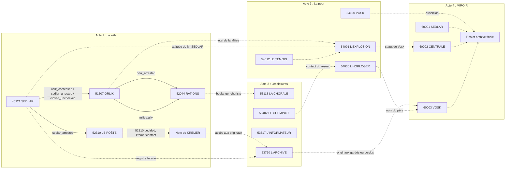

# Dépendances entre dossiers

Traits pleins : codé (sur `main` ou sur la branche `claude/acte-1`).
Traits pointillés : proposé. Les étiquettes sont les drapeaux qui font le lien.

## Ressources de fin et dossiers qui les donnent

| Ressource | Donnée par | Perdue par | Fins concernées |
| --- | --- | --- | --- |
| Originaux de KREMER | Note de fin d'acte 1, 53760 (protéger ou copier) | Livrer KREMER sans copie | La Correction, La Fuite des originaux |
| Contact du réseau | 53402, 54030 | Dénoncer les passages | L'Heure juste |
| Faveurs de la Milice | 51307 (classement), 54001 | Arrêter B. ORLIK, accuser les détournements | L'Allié de la Milice |
| Confiance du ministère | Conclusions solides, concordance VERITAS | Mettre en cause un service, contredire la Section 7 | Le Miroir parfait |
| Innocents épargnés | 52044, 52310, 53118, 53517, 54001 | Les arrêter | La Correction |

## Drapeaux posés mais pas encore lus

Vérification du 2026-10-24 : `40921.orlik_exposed`, `52044.closed`,
`52044.drazek_transferred`, `52044.drazek_warned`, `52044.innocent_condemned`,
`52310.decided`, `52310.identity_questioned`, `52310.innocent_condemned`,
`52310.poem_cleared`, `52310.varga_arrested`, `kremer.contact`, `milice.enemy`,
`ministry.embarrassed`, `player.bribed`, `player.noticed_by_halm`,
`player.reprimanded` (lu par l'évaluation), `section7.hostile`.
Proposition : un test automatique qui liste les drapeaux orphelins, avec une
liste blanche des drapeaux réservés aux actes suivants.
